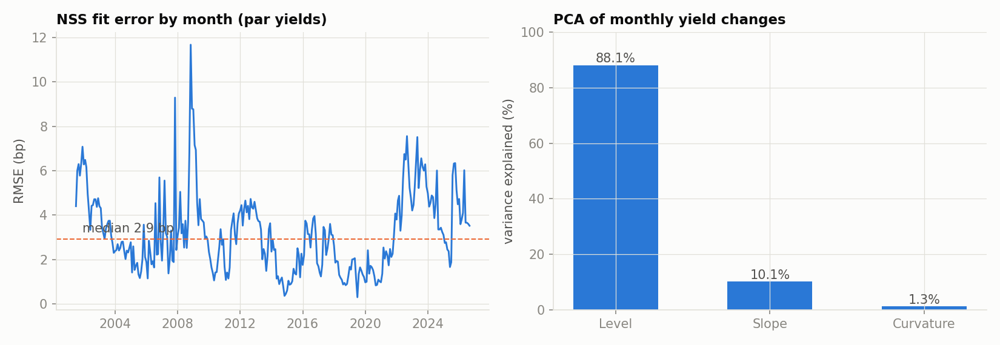
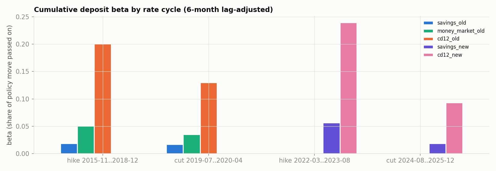
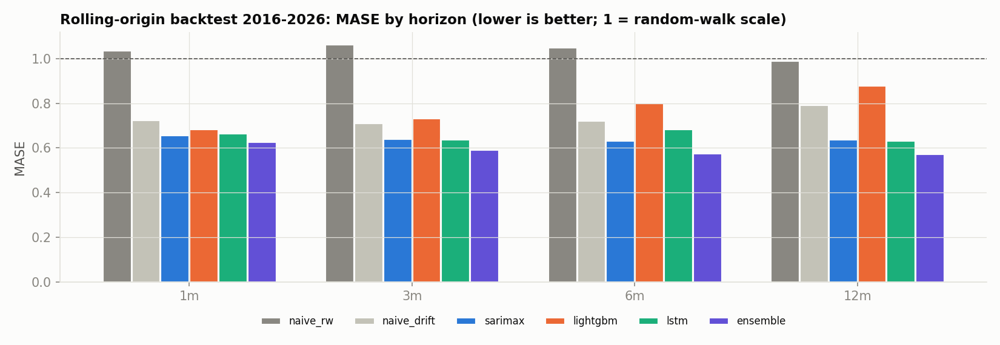
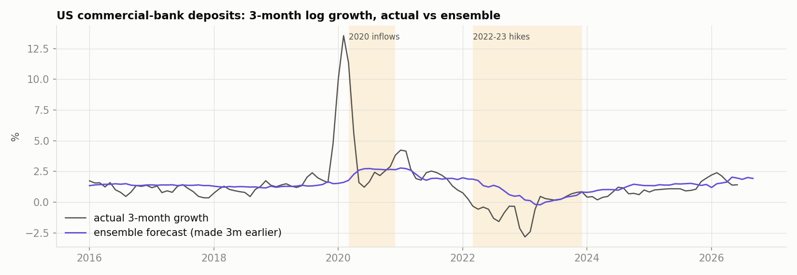
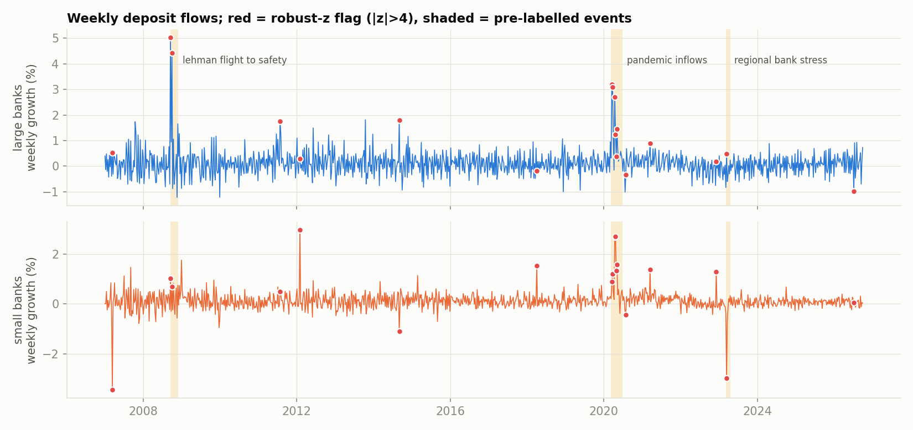
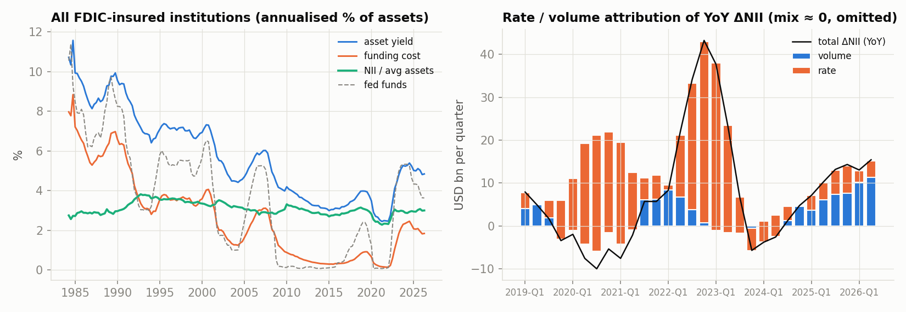
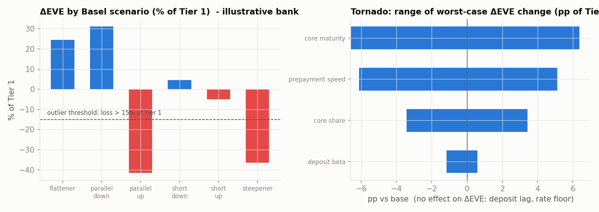
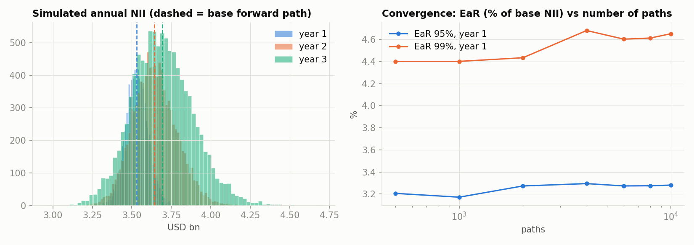

# Treasury ALM Analytics: deposit behaviour, NII forecasting and IRRBB stress testing

Author: Abdulla Swalih NM · Python 3.11+ · real US data from FRED · every number below is written by code into [`results/summary.json`](results/summary.json).

A bank treasury has to answer three questions: **how much will deposits cost as rates move, how many deposits will we keep, and how exposed are earnings and economic value to rate shocks?** This repository answers them on real US banking data (FRED and the FDIC Quarterly Banking Profile), then applies the results to an **illustrative** bank under the Basel IRRBB standard.

> **Read this first.** The bank in Modules 7–8 (balance sheet, Tier 1 capital, product rates, prepayment parameters, core-deposit shares) is **made up** for demonstration (`config/balance_sheet.yaml`, assumptions I11 in [`docs/assumptions_register.md`](docs/assumptions_register.md)). It was fixed before results were seen and not re-tuned. It is a deliberately rate-sensitive bank, and it fails the outlier test by a wide margin. Everything else (rates, curves, deposit betas, forecasts, anomalies, industry NII) is estimated from real data.

## Results at a glance

| Module | Headline (all from `summary.json`) |
|---|---|
| Data | 28 FRED series, vintage 2026-10-14, pandera-validated; FDIC deposit-rate methodology break (Mar/Apr 2021) kept as two regimes |
| Curves | Nelson-Siegel-Svensson on 303 months: **median fit error 2.9 bp**; PCA level/slope/curvature = 88.1% / 10.1% / 1.3% of yield-change variance |
| Deposit betas | Savings: **1.9%** of the 2015–18 hikes passed on vs **5.7%** in 2022–23; 12M CD: 20.1% → 24.0% (6-month lag-adjusted, national average rates) |
| Deposit forecasts | 11-fold rolling-origin backtest (2016–2026): ensemble MASE **0.593** vs 1.036 random walk (**−42.8%**) and 0.740 drift (**−19.9%**); conformal coverage 80.6% (nominal 80%) and 94.2% (nominal 95%) |
| Anomalies | Lehman 2008, pandemic 2020 and SVB 2023 all detected (**recall 3/3**) but precision by episode is low (0.18–0.80) |
| NII drivers | Rate level + slope explain **8.9%** of NII-margin variation in levels; in the 2022–23 cycle **99%** of the rise in industry NII was a rate effect, 0.8% volume |
| IRRBB (illustrative bank) | Worst ΔEVE **−41.6% of Tier 1** (parallel up) → **outlier**; ΔNII +10.0% (up) / −12.1% (down) |
| NII-at-Risk (Hull-White, 10,000 paths) | 95% EaR **3.3% / 5.9% / 8.1%** of base NII in years 1 / 2 / 3; 99% EaR 4.7% / 8.4% / 11.4% |
| Engineering | 66 tests passing, 97.1% coverage, `ruff` and `mypy --strict` clean |

### What did *not* work (kept on purpose)

* **“Banks pass cuts on faster than hikes” is not supported.** In the 2009–2021 regime up-betas were larger than down-betas (savings 4.6% vs 1.4%, p = 0.016; 12M CD 36.8% vs 13.3%, p = 0.012); no significant asymmetry in the new regime. Part of this is a zero-floor effect.
* **The LSTM does not beat SARIMAX** on average (mean MASE 0.656 vs 0.643); it wins only at the 12-month horizon. LightGBM is the weakest model (0.776) on ~600 monthly rows.
* **In 2022–23 the random walk beat every model** (MASE 0.53 vs 0.81 for the best, LSTM): deposits stagnated while the models extrapolated earlier growth.
* **Input drift is RED** for all six drivers (PSI 2.1–5.9 vs the ≤ 2015 training sample); current rolling forecast error is GREEN (MASE 0.37).
* **Cointegration evidence is mixed** (Engle-Granger p ≥ 0.54 everywhere; Johansen rejects in 4 of 8 samples). The first Kalman-beta specification was degenerate and was replaced.
* **NII margin is mostly regime shifts, not rate level:** adding 2008 and 2020 break dummies lifts R² from 0.09 to 0.35 and makes rate level and slope insignificant.
* **The Module 4 residual detector misses March 2023** (large-bank inflows offset small-bank outflows in the aggregate).

## Charts

| | |
|---|---|
|  |  |
|  |  |
|  |  |
|  |  |

More: `02_time_varying_beta.png`, `09_repricing_gap.png` in `reports/figures/`.

## The P&L story (Module 6)

Across 2021-Q4 → 2023-Q4 industry NII/assets rose from 2.33% to 2.97% (peak 3.05% in 2022-Q4). Asset yields went from 2.48% to 5.27% while funding costs went from 0.14% to 2.30%, because deposit betas were low: the industry funding-cost beta against the fed funds rate was 41% (versus 5.7% for the national savings rate; funding also includes CDs and wholesale). Rate/volume attribution on aggregate data: of the +37.6bn rise in quarterly NII, 37.2bn is the rate effect and 0.3bn volume. See [`docs/model_cards/05_nii_drivers.md`](docs/model_cards/05_nii_drivers.md).

## Pipeline

```
FRED ─► M1 data (Polars, pandera) ─┬► M2 NSS curve + PCA ─────────────┐
                                   ├► M3 deposit betas (ECM, Kalman) ─┤
                                   ├► M4 deposit forecasting ─► M5 anomalies
                                   └► M6 NII drivers / attribution     │
                                                                       ▼
                          M7 Basel IRRBB engine (ΔEVE ×6, ΔNII ×2, outlier test)
                                                                       ▼
                          M8 Hull-White Monte Carlo NII-at-Risk (dynamic balance sheet)
```

## Run it

```bash
pip install -e ".[dev]"
echo FRED_API_KEY=your_key > .env        # free key: fred.stlouisfed.org (the file is gitignored)
make data curves betas backtest nii irrbb montecarlo report   # or: python -m treasury_alm.cli <command>
python -m treasury_alm.cli monitor       # drift / error / beta-stability status
python -m treasury_alm.cli quality       # tests + coverage + lint/type exit codes -> summary.json
make serve                               # FastAPI at :8000  (POST /irrbb/run)
streamlit run dashboard/app.py           # interactive dashboard with assumption sliders
docker compose up                        # API + dashboard + MLflow UI
```

`backtest` takes about 5 minutes (TensorFlow LSTM, SARIMAX). Forecasting runs are tracked in MLflow (`mlflow ui --backend-store-uri sqlite:///mlflow.db`).

Example API call:

```bash
curl -X POST localhost:8000/irrbb/run -H "content-type: application/json" \
     -d '{"currency":"GBP","scenarios":["steepener","parallel_up"],"beta_multiplier":2.0}'
```

## Repository map

* `src/treasury_alm/` typed package (`data`, `curves`, `deposits`, `pnl`, `irrbb`, `simulation`, `api`, `monitoring`, `cli`). Abstract bases: `BaseForecaster`, `BaseShock`, `BaseProduct`.
* `config/` FRED series, Basel parameters (verified against SRP31, with paragraph references), illustrative balance sheet, derived betas.
* `docs/` model cards (7), assumptions register, validation report, monitoring plan. `PROGRESS.md` is the build log.
* `tests/` 66 tests: unit, property-based (`hypothesis`), parameter recovery, leakage, closed-form EVE, integration (sandboxed), API.

## Honest limitations

* Illustrative bank; non-USD currencies use the US curve with that currency's Basel shock sizes.
* National average deposit rates understate the betas of rate-sensitive depositors; the post-2021 regime has one full rate cycle.
* Basel rotation-shock coefficients were recovered from the SRP31.92 worked example (the formulas are images on the BIS site); the post-shock floor level (−1% rising to 0 at 20 years) is my assumption.
* Hull-White is Gaussian and single-factor; history is fat-tailed (excess kurtosis 7.4). The deposit-volume model in the simulation is weak (R² 0.07).
* Unlabelled anomaly episodes count as false alarms; only three labelled events exist.
* This is a developer self-assessment, not an independent validation.

## Resume bullets (filled only from `summary.json`)

**Treasury ALM Analytics: Deposit Pricing, NII & IRRBB** | *Python, Polars, statsmodels, TensorFlow, LightGBM*

* Estimated deposit betas on FRED/FDIC data with error-correction and Kalman-filter models: savings rates passed through **5.7%** of the 2022–23 Fed hikes vs **1.9%** in 2015–18 (6-month lag-adjusted), and found **no evidence** of faster pass-through on cuts than hikes.
* Forecast US bank deposits with SARIMAX, LightGBM and a TensorFlow LSTM in an **11-fold** rolling-origin backtest; the ensemble cut MASE **42.8%** vs a random walk (**19.9%** vs drift), with conformal intervals at **94.2%** coverage at the 95% level; anomaly detectors flagged the 2008, March 2020 and March 2023 deposit shocks (3/3).
* Modelled NII drivers and rate/volume attribution on FDIC data for all US banks (1984–2026): policy rate and curve slope explain **8.9%** of NII-margin variation, and **99%** of the 2022–23 rise in NII was a rate effect.
* Built a Basel IRRBB engine (19 buckets, six shock scenarios, core-deposit caps, 15% Tier 1 outlier test) and a Hull-White Monte Carlo: on an illustrative bank ΔEVE was **−41.6%** of Tier 1 under a parallel +200 bp shock, 95% NII-at-Risk **3.3%** (year 1) to **8.1%** (year 3); shipped as a **66-test, 97%-coverage** FastAPI + Streamlit service.

## License

MIT, see [LICENSE](LICENSE). Data are from FRED (Federal Reserve Bank of St. Louis) and the FDIC; the sample bank is illustrative and not a real institution.
